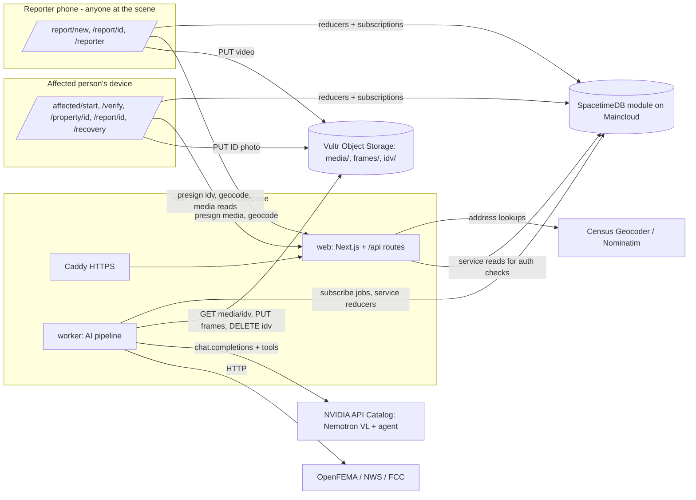

# Technical Architecture

Design baseline: Saturday, November 7, 2026. Product behavior comes from [IDEA.md](IDEA.md), exact interfaces from [CONTRACTS.md](CONTRACTS.md), and ownership from [IMPLEMENTATION_PLAN.md](IMPLEMENTATION_PLAN.md). Items marked **VERIFY** must be confirmed by the owner in the first hour against the live provider. Record the result in your `status/partN.md` and, if it changes an interface, in CONTRACTS.md.

## 1. Decisions

| Layer | Choice | Why |
|---|---|---|
| Language / repo | TypeScript everywhere, Node 24 LTS, pnpm workspaces | One language, shared Zod types, fewest seams between four LLMs |
| Backend + DB + realtime | **SpacetimeDB** TypeScript module (`spacetimedb/`), hosted on **Maincloud** (credit code `HACKUTD2026`) | Tables, reducers (server logic), identity, verification-gated access and live subscriptions in one system. Sponsor track |
| Web | Next.js 16 App Router + React + Tailwind + shadcn/ui; SpacetimeDB TS client SDK | Mobile-first reporter capture flow and affected-person pages. Route Handlers only for what SpacetimeDB shouldn't do (presigned uploads, geocoding proxy, signed media reads, health) |
| AI vision | **Nemotron Nano VL** via NVIDIA API Catalog (`build.nvidia.com`), OpenAI-compatible endpoint | Damage findings per frame **and** field extraction from ID documents. Sponsor track |
| AI agent | **Nemotron** reasoning/tool-calling LLM via the same endpoint, with a bounded tool loop | Multi-step, tool-integrated, "beyond a chatbot". Sponsor track |
| AI worker | `apps/worker`: Node process that connects to SpacetimeDB as a service identity, claims jobs, runs ffmpeg + Nemotron, and writes results via reducers | Slow work and network I/O stay out of reducers (reducers must be fast and deterministic) |
| Media storage | **Vultr Object Storage** (S3-compatible) with presigned PUT/GET; `@aws-sdk/client-s3` | Footage and ID images don't belong in DB rows. Sponsor track |
| Geocoding | **US Census Geocoder** (forward: address → lat/lng) and **Nominatim / OSM** (reverse: GPS → address), proxied through `/api/geocode` | Free, no keys. Respect Nominatim's usage policy: at most 1 req/s and a descriptive generic User-Agent |
| Maps | Leaflet + OpenStreetMap tiles (with attribution; low volume) | Free, no key. Reporter pin map and affected-person cell map |
| Hosting | **Vultr** Ubuntu VM: Docker Compose (web, worker, caddy). Caddy for automatic HTTPS | Simple, cheap, one box. Sponsor track |
| Domain | GoDaddy Registry domain → A record → VM | Sponsor track |
| Charts | Recharts | Forecast chart and indicators |
| Public data APIs | OpenFEMA (disaster declarations), NWS `api.weather.gov` (active alerts), FCC Area API (lat/lng → county/state FIPS) | Free; no keys. Real-world grounding |

### Alternatives rejected

- A separate Postgres + Express API: duplicates what SpacetimeDB gives us and adds a merge-heavy layer.
- Python CV service: a second language and runtime. Nemotron VL removes the need for custom CV models.
- A commercial identity-verification provider (Stripe Identity, Persona) in the first build: account approval and integration risk. It's the production path and a stretch goal. The hackathon build uses a **demo-grade** check (§6.5), labeled as such.
- Self-hosting Nemotron on a GPU: setup risk. The hosted NIM endpoint first; Brev/Vultr GPU only as a stretch goal.

## 2. System diagram



Browsers talk to SpacetimeDB **directly** over the SDK websocket. The Next.js server handles page rendering, presigned URLs, the geocoding proxy, authorized media reads and health. There are no other REST endpoints.

## 3. Repository layout

```text
/
├─ AGENTS.md CLAUDE.md README.md IDEA.md ARCHITECTURE.md CONTRACTS.md
├─ IMPLEMENTATION_PLAN.md WORKFLOW.md STATUS.md SOURCES.md
├─ status/part1.md … part4.md          # append-only progress logs, one per owner
├─ docs/                                # DEMO, DEPLOYMENT, KICKOFF_PROMPTS
├─ package.json pnpm-workspace.yaml pnpm-lock.yaml tsconfig.base.json .prettierrc eslint.config.mjs
├─ spacetimedb/                         # SpacetimeDB TS module (Part 2)
│  └─ src/index.ts, tables/*.ts, reducers/*.ts, auth.ts, access.ts, matching.ts, address.gen.ts (generated copy, see §5)
├─ packages/
│  ├─ contracts/      # Zod schemas + types, split by domain file (see CONTRACTS.md §0)
│  │  └─ src/common.ts report.ts property.ts (P2) · assessment.ts agent.ts verification.ts (P3) · finance.ts (P4) · index.ts
│  ├─ stdb-bindings/  # GENERATED by `spacetime generate`; never hand-edit
│  ├─ address/        # pure: normalizeAddress, matchAddresses, haversineM, cellId/cellBounds (Part 2)
│  ├─ agent/          # Nemotron client, tool loop, prompts, tools (Part 3)
│  ├─ vision/         # ffmpeg frame extraction, VL damage + ID-document prompts, validation (Part 3)
│  ├─ damage/         # deterministic repair-cost model (Part 3)
│  ├─ finance/        # recovery engine, indicators, forecast, simulator, personas, plan + coach handlers (Part 4)
│  └─ storage/        # S3/Vultr object storage helpers (Part 4)
├─ apps/
│  ├─ web/
│  │  ├─ app/                  # routes, per-owner folders (§9)
│  │  ├─ components/ui/        # shadcn kit (P1)
│  │  ├─ components/map/       # <PinMap>, <CellMap> Leaflet wrappers (P1; used by P1 and P2)
│  │  ├─ components/safety/    # <Banner911>, <HazardList>, guidance text (P1; used by both views)
│  │  ├─ components/report/    # reporter capture-flow pieces (P1)
│  │  ├─ components/affected/  # address entry, verification, property pages (P2)
│  │  ├─ components/damage-report/  # <DamageReport> frames/findings/cost/claim (P3)
│  │  ├─ components/agent-trace/    # <AgentTrace> (P3)
│  │  ├─ components/finance/   # Navigator + <RecoverySummaryCard> (P4)
│  │  └─ lib/stdb/             # connection provider + typed hooks (P2)
│  └─ worker/         # job runner host + handler registry (Part 3)
├─ scripts/           # admin-*.ts (Part 2), smoke-*.ts (each owner, own file)
├─ fixtures/          # labeled JSON fixtures per domain (owner per subfolder); media URLs list only
└─ infra/             # Caddyfile, compose.yaml, Dockerfiles, deploy scripts (Part 4)
```

## 4. Data flows

### 4.1 A reporter submits a report

```mermaid
sequenceDiagram
  participant R as Reporter (web)
  participant W as web (Next API)
  participant B as Object Storage
  participant S as SpacetimeDB
  participant K as Worker
  participant N as Nemotron
  R->>W: GET /api/geocode?lat&lng  (GPS → suggested addresses)
  R->>R: confirm/edit address; generate reporterSecret (kept in localStorage)
  R->>S: create_report(input, sha256(reporterSecret)) → match/create property; report status=draft
  R->>W: POST /api/uploads/presign {kind:'media', reportId, reporterSecret, ...}
  W->>S: (service read) check secret hash
  W-->>R: {putUrl, objectKey}
  R->>B: PUT video
  R->>S: attach_media(...) ; submit_report(reportId) → status=queued, job(analyze)
  S-->>K: subscription: new job
  K->>S: claim_job(jobId) (atomic lease)
  K->>B: GET video → ffmpeg → ≤8 keyframes → PUT frames/
  K->>N: VL per frame → FrameFinding JSON (Zod)
  K->>S: record_frame, record_agent_step (pipeline steps visible to reporter)
  K->>N: agent loop (context, findings, geocode, FEMA, NWS, cost, claim draft)
  K->>S: record_assessment → report.overall_level / life_safety; area_cell_summary updated
  K->>S: complete_job
  S-->>R: live status, hazards, damage level (reporter view)
```

### 4.2 The affected person verifies and gets access

```mermaid
sequenceDiagram
  participant A as Affected person (web)
  participant W as web (Next API)
  participant B as Object Storage
  participant S as SpacetimeDB
  participant K as Worker
  participant N as Nemotron VL
  A->>W: GET /api/geocode?q=<typed address> → NormalizedAddress[]
  A->>A: generate verificationSecret (localStorage)
  A->>S: start_verification(address, doc_kind, sha256(secret)) → match/create property; verification(pending) with property_id; rate limit 3/h
  A->>W: POST /api/uploads/presign {kind:'idv', verificationId, verificationSecret, image}
  A->>B: PUT ID photo → idv/<verificationId>/<uuid>.jpg
  A->>S: submit_verification(verification_id, object_key) → job(verify_identity)
  K->>S: claim_job ; verification → processing
  K->>B: GET idv object
  K->>N: VL: ID photo → IdDocumentFields (Zod)
  K->>K: deterministic match (packages/address) vs property address; expiry check
  K->>B: DELETE idv object (always, in finally)
  K->>S: record_verification(ok | fail_reason, name_on_doc)
  S-->>S: on ok: report.claimed = true for every report on that property
  S-->>A: verification=verified → property page; reports + frames + assessments now visible
  S-->>R: reporter's "My submissions" badge flips to claimed (live)
```

### 4.3 Finance intake → recovery plan

```mermaid
sequenceDiagram
  participant A as Affected person (web)
  participant S as SpacetimeDB
  participant K as Worker
  A->>S: save_affected_intake(property_id, intake_json, report_id?) (verified only) → job(plan)
  K->>S: claim_job
  K->>K: estimateRepairCost(assessment findings, intake sqft/stories/tenure)  (packages/damage)
  K->>K: buildRecoveryPlan(persona, insurance, updated cost, declarations)  (packages/finance)
  K->>K: optional coachSummary via Nemotron (grounded in plan JSON)
  K->>S: record_recovery_plan(identity, property_id, report_id, json) ; complete_job
  S-->>A: Navigator renders; what-if runs client-side via simulate()
  A->>S: ask_coach(property_id, report_id, text) → job(coach) → record_coach_reply
```

### 4.4 State machines

- `report.status`: `draft → queued → processing → assessed`, with side exits `needs_more_footage` (more than half the frames unusable; the **reporter** is asked to re-shoot or add photos and resubmits the same report) and `failed` (after 2 attempts; "Try again"). Low confidence (< 0.5) still ends in `assessed` with a "low confidence" label.
- `report.claimed` is a separate boolean. It becomes `true` once any identity is verified for the report's property, including when a report is filed for a property that already has a verified person.
- `verification.state`: `pending → processing → verified | failed`. A failed verification can be retried with a new `start_verification` (rate limited), optionally with a second document (`utility_bill` / `insurance_declarations`).

## 5. SpacetimeDB design (Part 2)

- **Identity and roles are derived from data, not assigned.** Every browser gets an anonymous SpacetimeDB identity and token (persisted in `localStorage`). An identity is a **reporter** of the reports where `report.reporter = ctx.sender`. It's an **affected person** for a property when a `verification` row exists with `identity = ctx.sender`, that `property_id` and `state = 'verified'`. The worker uses a **service identity** in `service_identity`. The `init` reducer adds the publisher as `admin`, and the admin adds the worker.
- **Reducers are the only write path.** Every reducer checks authorization first using helpers in `spacetimedb/src/auth.ts` (`isService`, `isReporterOf(reportId)`, `isVerifiedFor(propertyId)`).
- **Reducers must be fast and deterministic.** No network or model calls. Geocoding happens in `/api/geocode` before `create_report` / `start_verification`. All AI happens in the worker.
- **Property matching** (`spacetimedb/src/matching.ts`). Given a `NormalizedAddress`:
  1. an exact match on `property_private.normalized`; else
  2. any property in the same or neighboring `cell_id` within **30 m** (haversine) of the geocode point; else
  3. create a new property.
  The address helpers come from `packages/address`. **VERIFY (hour 1)** whether the module build can import a workspace package. If it can't, `pnpm address:sync` copies the pure source to `spacetimedb/src/address.gen.ts` (generated, never hand-edited; the CI check fails if it's stale).
- **Access gating** (`spacetimedb/src/access.ts`). Reporters can read their own `report_private` and their own reports' `agent_step` rows with `visibility = 'reporter'` (pipeline status only). Verified affected persons can read everything attached to their property: `property_private`, `report_private`, `media_asset`, `frame`, `assessment`, all `agent_step` rows. Each identity can read only its own `verification`, `affected_profile`, `recovery_plan` and `coach_message` rows.
  - **VERIFY (Part 2, hour 1):** the SpacetimeDB 2.x mechanism for per-identity reads of private tables (views / RLS / client-visibility filters).
  - **Preferred:** views keyed on `ctx.sender`, joined to `verification`.
  - **Fallback:** Next.js route `GET /api/private/[...]` (Part 2) that reads with the service token and authorizes with the client-generated secret (reporter secret or verification secret; only SHA-256 hashes are stored in the module). Record whichever path works in CONTRACTS.md §5 and tell the team.
- **Area map data.** `area_cell_summary` (public) is updated incrementally by `record_assessment` (report count, worst level, hazard-report count, severe-hazard count, distinct hazard flags only when the cell has ≥3 reports, and last report time per ~250 m cell). A scheduled `refresh_area_cells` reducer (every 5 min) recomputes the 72-hour window from `report`. No public table holds an address or exact coordinates. `report` carries only `cell_id`.
- **JSON columns for nested AI/finance output.** Assessment, findings, plan and intake are stored as JSON strings validated against `packages/contracts` by the writer. Scalar columns needed for filtering and subscriptions (status, level, claimed, cell, state) are real columns. Schema migrations stay rare.
- **Concurrency.** `claim_job` runs inside a reducer transaction, so two workers can't take the same job. `start_verification` enforces a limit of 3 per identity per rolling hour.
- **Publishing.** Use `spacetime publish` to Maincloud. For breaking schema changes during the hackathon, use `--delete-data`, announced first; test data is lost. Bindings are generated into `packages/stdb-bindings` and committed.

## 6. AI pipeline (Part 3)

### 6.1 Frames

- Download the media to a temp dir. Videos are capped at 120 s / 200 MB, enforced at presign and again in the worker.
- `ffmpeg` (via `ffmpeg-static`): scene-change frames (`select='gt(scene,0.3)'`), filled to 1 frame per 4 s if too few, then **capped at 8**, evenly spread. Scale to 768 px long edge, JPEG q80. Photo uploads skip ffmpeg; cap 8.
- Upload thumbnails to `frames/<reportId>/<n>.jpg`, then `record_frame`.

### 6.2 Vision: damage findings

- Model: `NEMOTRON_VL_MODEL` (default `nvidia/nemotron-nano-12b-v2-vl`). **VERIFY** the model ID, the image input format (base64 data URL in `image_url`), max images per request and rate limits.
- One call per frame (concurrency `VL_CONCURRENCY`), or multi-image batches if reliable. The system prompt asks for **only** JSON matching `FrameFinding` (CONTRACTS.md §3.1). Zod-parse it. On failure, retry once with the validation error included, then mark the frame `unusable` / `parse_error`.
- Prompts live in `packages/vision/src/prompts/*.ts`, each with a `PROMPT_VERSION` stored on the output.

### 6.3 Agent: Nemotron tool loop (`analyze` job)

- Model: `NEMOTRON_AGENT_MODEL`. **VERIFY** which current Nemotron chat model supports OpenAI-style `tools` reliably (candidates in SOURCES.md). **Fallback:** a JSON "next action" protocol (`{"action":"call_tool",…}` / `{"action":"finish",…}`) parsed with Zod; the loop code is unchanged.
- Client: the `openai` npm SDK with `baseURL = NVIDIA_BASE_URL`.
- Limits: max **12** steps, 90 s wall clock, 10 s per tool. Every model turn and tool call/result is recorded with `record_agent_step`. Pipeline progress steps get `visibility='reporter'`; everything else gets `visibility='affected'`.
- **The `analyze` job no longer builds a recovery plan.** The affected person's finance data doesn't exist yet when a report is filed.

| Tool | Owner | What it does | Deterministic? |
|---|---|---|---|
| `get_report_context` | P3 | Hazard, reporter's danger answer and notes, cell/county, default home-size assumptions | yes |
| `get_frame_findings` | P3 | All validated FrameFindings for the report | yes |
| `reverse_geocode` | P3 | FCC Area API: lat/lng → state, county name and FIPS | yes (external) |
| `lookup_disaster_declarations` | P3 | OpenFEMA `DisasterDeclarationsSummaries` for state + county, recent and open | yes (external) |
| `get_weather_alerts` | P3 | NWS `/alerts/active?point=lat,lng` | yes (external) |
| `estimate_repair_cost` | P3 | Cost model (CONTRACTS.md §6) using component levels. Uses **assumed defaults** (1,800 sqft, 1 story, own) and labels them | **yes, code-only** |
| `draft_claim_notice` | P3 | Model writes a first-notice-of-loss summary from findings (text only) | model |
| `finish` | P3 | Final `DamageAssessment` (minus code-computed fields), Zod-validated | — |

The model decides **what to look up and how to explain it**. Code decides **numbers**: cost, money math and indicator thresholds. `summary` and `recommendedActions` must not contain dollar figures that didn't come from a tool result; a post-check rejects free-floating `$` amounts not present in tool outputs.

### 6.4 Plan and coach jobs (handlers owned by Part 4)

- **`plan`**: reads the chosen assessment (default: the most severe `assessed` report on the property) and the identity's `affected_profile`. It reruns `estimateRepairCost` from `packages/damage` with the intake's `homeSqft` / `stories` / `tenure`, so the plan's cost reflects the real home. The stored assessment is unchanged. It then calls `buildRecoveryPlan`, optionally writes a model `coachSummary`, and calls `record_recovery_plan`.
- **`coach`**: answers one question grounded in that identity's plan JSON and the assessment. The reply never introduces numbers that aren't in the plan.

### 6.5 Identity verification (`verify_identity` job, Part 3)

1. Load the `verification` row and its property's normalized address (service read).
2. `GET idv/<verificationId>/<uuid>.jpg` from storage.
3. Run Nemotron VL with the ID-document prompt (`packages/vision/src/prompts/id-document.ts`): return **only** `IdDocumentFields` JSON (CONTRACTS.md §3.3), meaning doc kind, full name, address text, expiration, `isLikelyId` and confidence. Zod-parse, with one retry.
4. Decide deterministically: not a likely ID → `not_an_id`; confidence < 0.5 → `unreadable`; expiration in the past (IDs only) → `expired`; `matchAddresses(docAddress, propertyAddress)` false → `address_mismatch`; otherwise `ok`. The doc address is normalized through `packages/address` (no network geocode needed; on a mismatch, optionally retry once after geocoding the doc address via the Census Geocoder).
5. **`storage.deleteObject(key)` in a `finally` block, always.** Log only the key, never the fields. The bucket also has a lifecycle rule deleting `idv/` objects after 1 day as a backstop (**VERIFY** that Vultr supports lifecycle rules; if not, the worker sweeps on startup).
6. `record_verification(verification_id, ok, fail_reason?, name_on_doc?)`. Only the name, the result and timestamps are kept. The doc's address text, document number and image are not stored.
7. This is labeled everywhere as a **demo identity check, not production-grade verification**. It's demonstrated only with specimen/sample IDs or a team member's own ID with consent.

### 6.6 Jobs

- The `job` table (private) holds the queue: `kind ∈ {analyze, verify_identity, plan, coach}`. The worker subscribes to `queued` jobs, calls `claim_job(jobId, leaseMs=120000)`, and proceeds only when the subscription shows `leaseOwner == self`.
- On crash, the lease expires and `requeue_expired_jobs` (every 30 s) requeues it. Max 2 attempts, then `failed` (report → `failed`, or verification → `failed` / `unreadable`).
- Handler registry: `apps/worker/src/handlers/index.ts`, one import per line: `analyze`, `verify_identity` (P3), `plan`, `coach` (P4: `packages/finance/src/jobs/plan-handler.ts`, `packages/finance/src/coach/handler.ts`).

## 7. Financial engine (Part 4)

- `packages/finance` is **pure TypeScript** with no I/O, imported by the worker (plan, coach) and the browser (instant what-if simulator).
- Inputs: `AffectedIntake` (household, tenure, home size, insurance, persona), the chosen `DamageAssessment` (findings + declarations), and the recomputed `CostEstimate`.
- Outputs: `RecoveryPlan` (CONTRACTS.md §4), keyed by identity + property + report.
  - **Indicators** (5): liquidity runway, emergency-fund coverage of the gap, debt-to-income, credit utilization, insurance gap ratio.
  - A **90-day forecast** of liquid balance vs. scheduled obligations.
  - **Funding options**, each with cost-of-funds and days-to-funds, ranked deterministically.
  - The model only writes `coachSummary` and coach replies.
- Personas live in `packages/finance/src/personas/*.ts`, labeled synthetic (at least 3: a stretched young renter, a mid-career family homeowner with a mortgage, a retiree with a CD and IRA).

## 8. Geocoding (Part 2: `/api/geocode`)

- **Forward** (`?q=`): US Census Geocoder `onelineaddress` (benchmark `CENSUS_GEOCODER_BENCHMARK`), returning matched addresses with coordinates. US-only, which suits us.
- **Reverse** (`?lat=&lng=`): Nominatim `reverse` (`format=jsonv2`, `addressdetails=1`) with `User-Agent: NOMINATIM_USER_AGENT` (a generic app name, never a personal email). Throttle to 1 req/s server-side and cache results by rounded coordinate.
- Both responses are mapped to `NormalizedAddress[]` via `packages/address.normalizeAddress`.
- **Manual fallback:** if both fail, the user types the full address and the client sends `source: 'manual'` with device coordinates (reporter) or none (affected). Matching then relies on the normalized string.
- **VERIFY** both endpoints, their response shapes and their rate limits in hour 1. Save sample responses to `fixtures/property/`.

## 9. Web app

| Route | View | Owner | Notes |
|---|---|---|---|
| `/` | both | P1 | Two CTAs: **Report damage** and **I've been affected** |
| `/report/new` | reporter | P1 | Hazard → GPS + suggested address (confirm/edit) → "Is anyone in danger right now?" + notes → "Is this your property?" → upload (video ≤ 120 s or ≤ 8 photos) → submit |
| `/report/[id]` | reporter | P1 | Live status timeline (reporter-visible steps), life-safety hazards + `<Banner911>`, overall damage level, claimed badge, a note on how the resident finds the report, re-shoot prompt on `needs_more_footage`. **No** frames, cost, claim draft or finances. Self-reports redirect to `/affected/start?prefill=` after submit |
| `/reporter` | reporter | P1 | "My submissions": `<PinMap>` (own reports only, colored by damage level, claimed/unclaimed badge) + list |
| `/affected/start` | affected | P2 | Address entry → `/api/geocode` → choose the match → continue to verify (the area map can render immediately from the client-computed `cellId`) |
| `/affected/verify` | affected | P2 | Doc kind → camera/photo capture → presign `idv` → `submit_verification` → live state → verified / failed with reason / "Try another document" |
| `/affected/property/[propertyId]` | affected (verified) | P2 | Report list (newest first) + `<CellMap>` (own pin + area cells, 72 h, ~1 km) + NWS/FEMA banner from the latest assessment + "Film it yourself" when there are no reports. Unverified visitors see area data only |
| `/affected/report/[id]` | affected (verified) | P2 shell | Embeds `<DamageReport>` (P3), `<AgentTrace>` (P3), `<HazardList>` / `<Banner911>` (P1), `<RecoverySummaryCard>` (P4) |
| `/affected/property/[propertyId]/recovery` | affected (verified) | P4 | Intake form → `save_affected_intake` → Navigator (indicators, gap, forecast, options, what-if, coach); report picker |
| `/api/geocode` | both | P2 | §8 |
| `/api/private/[...]` | both | P2 | Only if the §5 visibility fallback is used |
| `/api/uploads/presign` | both | P4 | kinds `media` (reporter) and `idv` (affected) |
| `/api/media/[...key]` | affected | P4 | Authorized redirect to a presigned GET, for verified affected persons of the key's property only. `idv/` keys are always refused |
| `/api/health` | — | P4 | web up, Spacetime reachable, storage reachable |

The SpacetimeDB connection provider and typed hooks live in `apps/web/lib/stdb/**` (P2). Every other part imports them and never opens its own connection. Client-generated secrets (`reporterSecret` per report, `verificationSecret` per verification) are stored in `localStorage` through a helper in `lib/stdb/secrets.ts`.

### Maps

| Map | Route | Data | Who sees it |
|---|---|---|---|
| `<PinMap>` "My submissions" | `/reporter` | The reporter's own reports. Coordinates come from their own `report_private`. Color by `overall_level` (none grey · affected yellow · minor orange · major red · destroyed black). Badge: claimed / unclaimed | The reporter only |
| `<CellMap>` "Recent reports in your area" | `/affected/property/[id]` | Their own property pin (exact) plus `area_cell_summary` cells within ~1 km from the last 72 h, with a **Damage / Hazards toggle**: Damage shades by worst level; Hazards shades by hazard-report count (amber/orange/red) and puts a ⚠ on cells with severe hazards (trapped, injury, fire, gas). The tooltip shows counts, and hazard types only when the cell has ≥3 reports. **No other pins or addresses** | The affected person (cells are public data; the pin needs verification) |

## 10. Privacy notes

- ID images exist only in `idv/` and only until the verification job finishes (deleted in `finally`, with a 1-day lifecycle backstop). The `/api/media` route never serves them. Extracted address text and document numbers are never persisted.
- Public tables contain no address, exact coordinates, names or finances. The area map uses aggregated ~250 m cells.
- Reporters never get frames, costs, claim drafts or finances. Affected persons never see who filmed their home (only that a report exists).
- Secrets are generated client-side. The module stores only SHA-256 hashes.

## 11. Deployment

Details in [docs/DEPLOYMENT.md](docs/DEPLOYMENT.md). In short:

- **Vultr VM** (2 vCPU / 4 GB) runs Docker Compose with `caddy`, `web` and `worker`.
- **SpacetimeDB** runs on Maincloud. Fallback: the standalone `spacetimedb` container on the VM with a persistent volume.
- **Vultr Object Storage** private bucket with CORS for the domain and presigned URLs (10 min), plus an `idv/` lifecycle rule.
- **Domain** points at the VM; Caddy obtains TLS; `APP_BASE_URL` is the domain.
- Deploy early (hour 2) and redeploy after every merge to `main` (`infra/deploy.sh`).

## 12. Reliability and what must be tested

Each owner writes Vitest unit tests for their deterministic logic. These must pass before the demo:

- **P2:** `normalizeAddress` on a table of real-world variants (suffixes, directionals, units, ZIP+4, casing). `matchAddresses` positives and negatives, including different house numbers on the same street. Property matching (exact, within 30 m, new). Access gating: an unverified identity can't read `assessment` / `frame` / `media_asset`; a reporter can read only `visibility='reporter'` steps; a verified identity for property A can't read property B. `claimed` flips on verification and on new reports for verified properties. The verification rate limit. No PII in public tables. Job leases. Illegal status transitions are rejected.
- **P3:** FrameFinding / assessment / IdDocumentFields Zod validation on captured model outputs. The cost model gives exact cents on fixed inputs, with and without assumed defaults. Loop step cap, retry then unusable path, the dollar-figure post-check. **The ID object is deleted on every path** (ok, mismatch, parse error, thrown exception). Expired-ID and not-an-ID decisions.
- **P4:** indicator math, the forecast on a fixed persona, option ranking, and exact integer-cent arithmetic. The plan uses the recomputed cost. The simulator is pure and fast (< 20 ms). Presign rejects wrong kinds/types/sizes and bad secrets. `/api/media` refuses `idv/` keys and unverified callers.
- **P1:** capture-form validation; both maps render with fixtures; the full reporter journey on mobile Safari and Chrome (manual).
- **Everyone:** one end-to-end smoke run on the deployed URL (reporter on one device, affected person on another) before recording (`docs/DEMO.md` checklist).

## 13. Cost and quotas

- NVIDIA API Catalog: free developer credits/rate limits; **VERIFY** the limits. The worker backs off on 429s. Cache VL results by frame SHA-256 so demo re-runs don't re-bill. Don't cache ID results.
- Census Geocoder and Nominatim: free with fair-use limits. Throttle and cache in `/api/geocode`.
- Maincloud: the `HACKUTD2026` credit (about $38). Vultr: event credit via mlh.link/vultr. Domain: GoDaddy Registry code `MLHUTD84`.
- No paid services beyond those without a team OK. Part 4 keeps a ledger in `status/part4.md`.
