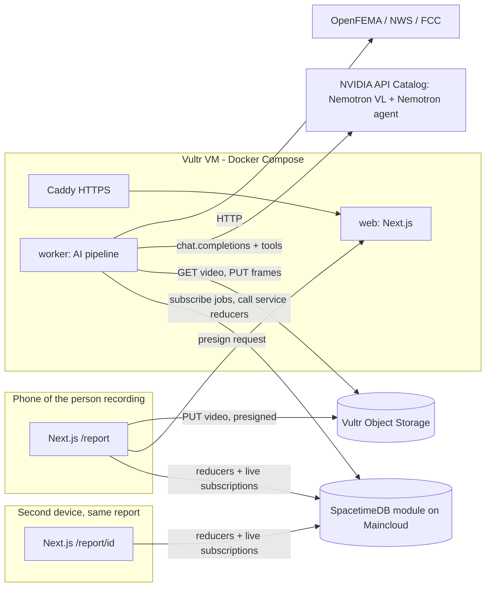

# Technical Architecture

Design baseline: Saturday, November 7, 2026. Product behavior comes from [IDEA.md](IDEA.md), exact interfaces from [CONTRACTS.md](CONTRACTS.md), and ownership from [IMPLEMENTATION_PLAN.md](IMPLEMENTATION_PLAN.md). Items marked **VERIFY** must be confirmed by the owner in the first hour against the live provider. Record the result in your `status/partN.md` and, if it changes an interface, in CONTRACTS.md.

## 1. Decisions

| Layer | Choice | Why |
|---|---|---|
| Language / repo | TypeScript everywhere, Node 24 LTS, pnpm workspaces | One language, shared Zod types, fewest seams between four LLMs |
| Backend + DB + realtime | **SpacetimeDB** TypeScript module (`spacetimedb/`), hosted on **Maincloud** (credit code `HACKUTD2026`) | Tables, reducers (server logic), identity and live subscriptions in one system. No separate API server, ORM or websocket layer to build. Sponsor track |
| Web | Next.js 16 App Router + React + Tailwind + shadcn/ui; SpacetimeDB TS client SDK | Mobile-first capture flow and live report pages. Route Handlers only for the things SpacetimeDB shouldn't do (presigned uploads, health) |
| AI vision | **Nemotron Nano VL** via NVIDIA API Catalog (`build.nvidia.com`), OpenAI-compatible endpoint | Frame-level structured damage findings. Sponsor track |
| AI agent | **Nemotron** reasoning/tool-calling LLM via the same endpoint, with a bounded tool loop | Multi-step, tool-integrated, "beyond a chatbot". Sponsor track |
| AI worker | `apps/worker`: Node process that connects to SpacetimeDB as a service identity, claims jobs, runs ffmpeg + Nemotron, and writes results via reducers | Long-running, slow work stays out of reducers (reducers must be fast and deterministic, with no network I/O) |
| Media storage | **Vultr Object Storage** (S3-compatible) with presigned PUT/GET; `@aws-sdk/client-s3` | Footage doesn't belong in a DB row. Sponsor track |
| Hosting | **Vultr** Ubuntu VM: Docker Compose (web, worker, caddy). Caddy for automatic HTTPS | Simple, cheap, one box. Sponsor track |
| Domain | GoDaddy Registry domain → A record → VM | Sponsor track |
| Charts | Recharts | Forecast chart and indicators |
| Public data APIs | OpenFEMA (disaster declarations), NWS `api.weather.gov` (active alerts), FCC Area API (lat/lng → county/state FIPS) | Free; no keys needed. Real-world grounding |

### Alternatives rejected

- A separate Postgres + Express API: duplicates what SpacetimeDB gives us and adds a merge-heavy layer.
- Python CV service: a second language and runtime. Nemotron VL removes the need for custom CV models.
- Self-hosting Nemotron on a GPU: setup risk. The hosted NIM endpoint first; Brev/Vultr GPU only as a stretch goal.

## 2. System diagram



Browsers talk to SpacetimeDB **directly** over the SDK websocket. The Next.js server is only for page rendering, presigned URLs, signed media reads and health. There are no other REST endpoints.

## 3. Repository layout

```text
/
├─ AGENTS.md CLAUDE.md README.md IDEA.md ARCHITECTURE.md CONTRACTS.md
├─ IMPLEMENTATION_PLAN.md WORKFLOW.md STATUS.md SOURCES.md
├─ status/part1.md … part4.md          # append-only progress logs, one per owner
├─ docs/                                # DEMO, DEPLOYMENT, KICKOFF_PROMPTS
├─ package.json pnpm-workspace.yaml pnpm-lock.yaml tsconfig.base.json .prettierrc eslint.config.mjs
├─ spacetimedb/                         # SpacetimeDB TS module (Part 2)
│  └─ src/index.ts, tables/*.ts, reducers/*.ts, auth.ts
├─ packages/
│  ├─ contracts/      # Zod schemas + types, split by domain file (see CONTRACTS.md §0)
│  ├─ stdb-bindings/  # GENERATED by `spacetime generate`; never hand-edit
│  ├─ agent/          # Nemotron client, tool loop, prompts, tools (Part 3)
│  ├─ vision/         # ffmpeg frame extraction, VL calls, finding validation (Part 3)
│  ├─ damage/         # deterministic repair-cost model (Part 3)
│  ├─ finance/        # recovery engine, indicators, forecast, simulator, personas, coach (Part 4)
│  └─ storage/        # S3/Vultr object storage helpers (Part 4)
├─ apps/
│  ├─ web/            # Next.js (Parts 1, 2, 3 and 4 own different route/component folders)
│  └─ worker/         # job runner host + handler registry (Part 3)
├─ scripts/           # admin-*.ts (Part 2), smoke-*.ts (each owner, own file)
├─ fixtures/          # labeled JSON fixtures per domain (owner per subfolder); media URLs list only
└─ infra/             # Caddyfile, compose.yaml, Dockerfiles, deploy scripts (Part 4)
```

## 4. Data flow: one report, end to end

```mermaid
sequenceDiagram
  participant R as Person recording (web)
  participant W as web (Next API)
  participant B as Object Storage
  participant S as SpacetimeDB
  participant K as Worker
  participant N as Nemotron
  R->>S: create_report(...)  → report + report_private rows (status=draft)
  R->>W: POST /api/uploads/presign {reportId, contentType, size}
  W-->>R: {putUrl, objectKey}
  R->>B: PUT video
  R->>S: attach_media(reportId, objectKey, ...) ; submit_report(reportId)
  S-->>S: status=queued, insert job(kind=analyze)
  S-->>K: subscription: new job
  K->>S: claim_job(jobId)  (atomic lease)
  K->>B: GET video → ffmpeg → ≤8 keyframes → PUT thumbs
  K->>S: record_frame(...) per frame; record_agent_step(...)
  K->>N: VL: frame(s) → FrameFinding JSON (Zod-validated)
  K->>N: Agent loop: tools (cost, FEMA, NWS, geo, finance, claim draft)
  K->>S: record_assessment(json) → updates report
  K->>S: record_recovery_plan(json) ; complete_job(jobId)
  S-->>R: live updates on every step (on every device with the report open)
```

Status machine (`report.status`): `draft → queued → processing → assessed` with side exits `needs_more_footage` (more than half the frames unusable) and `failed` (after 2 attempts). On `needs_more_footage` the report page asks the person recording to re-shoot or add photos, which resubmits the same report. Low confidence (< 0.5) still ends in `assessed` with a "low confidence" label.

## 5. SpacetimeDB design (Part 2)

- **Identity.** Every browser gets an anonymous SpacetimeDB identity and token (persisted in `localStorage` by the SDK). Whoever creates a report owns it (`ownerIdentity = ctx.sender`). There are no roles. The worker uses a **service identity** listed in the private `service_identity` table. The `init` reducer adds the publishing identity as `admin`, and the admin adds the worker identity.
- **Reducers are the only write path.** Every reducer checks authorization first (owner / service / admin) using helpers in `spacetimedb/src/auth.ts`.
- **Reducers must be fast and deterministic.** No network calls and no model calls. All AI and external I/O happen in the worker.
- **JSON columns for nested AI output.** Rich objects (assessment, recovery plan, findings) are stored as JSON strings validated against `packages/contracts` schemas by the writer, the worker. Scalar columns needed for sorting, filtering and subscriptions (status, score, tier, level, coarse lat/lng) are real columns. This keeps schema migrations rare, so Parts 3 and 4 can evolve their JSON shapes additively without touching the module.
- **Privacy.** The public `report` table holds only non-identifying status fields (status, hazard, damage level, frame counts), so the live status timeline is cheap to subscribe to. Everything else is in private tables readable only by the owner: exact address and contact, media keys, frames, full assessment, recovery plan, finances, coach chat, agent trace.
  - **VERIFY (Part 2, hour 1):** how SpacetimeDB 2.x exposes a private table's rows to the identity that owns them (views / RLS / client-visibility filters).
  - **Preferred:** owner-scoped views keyed on `ctx.sender`.
  - **Fallback:** a Next.js route `GET /api/reports/[id]/private` that reads with the service token and checks a per-report `ownerSecret` returned at creation and kept in the creating browser's `localStorage`. Whichever path works, write it into CONTRACTS.md §5 and tell the team.
- **Concurrency.** `claim_job` runs inside a reducer transaction, so two worker instances can't take the same job.
- **Publishing.** Use `spacetime publish` to Maincloud. Schema changes that would break existing data during the hackathon: publish with `--delete-data` (Part 2 announces this first). Test reports are lost; that's acceptable. Bindings are generated into `packages/stdb-bindings` and committed.

## 6. AI pipeline (Part 3)

### 6.1 Frames

- Download the media from object storage to a temp dir. Videos are capped at 120 s and 200 MB, enforced at presign and again in the worker.
- `ffmpeg` (via `ffmpeg-static`): pick scene-change frames (`select='gt(scene,0.3)'`), fill to 1 frame every 4 s if too few, then **cap at 8 frames**, evenly spread. Scale to 768 px on the long edge, JPEG quality 80. Images (photo uploads) skip ffmpeg; cap 8.
- Upload thumbnails to `frames/<reportId>/<n>.jpg`, then call `record_frame`.

### 6.2 Vision: Nemotron VL

- Model: `NEMOTRON_VL_MODEL` (default `nvidia/nemotron-nano-12b-v2-vl`). **VERIFY** the exact model ID, image input format (base64 data URL in `image_url`), max images per request and rate limits on build.nvidia.com.
- One call per frame (concurrency 4), or multi-image batches if supported and reliable. The system prompt asks for **only** JSON matching `FrameFinding` (CONTRACTS.md §3). Parse it with Zod. On failure, retry once with the validation error included, then mark the frame `unusable` with reason `parse_error`.
- Prompts live in `packages/vision/src/prompts/*.ts` with a `PROMPT_VERSION` constant that is stored on the assessment.

### 6.3 Agent: Nemotron tool loop

- Model: `NEMOTRON_AGENT_MODEL`. **VERIFY** on build.nvidia.com which current Nemotron chat model supports OpenAI-style `tools` / function calling reliably (candidates in SOURCES.md).
  - **Fallback if native tool calling is flaky:** a JSON "next action" protocol (`{"action":"call_tool","tool":"…","args":{…}}` or `{"action":"finish","assessment":{…}}`) parsed with Zod. The loop code stays the same.
- Client: the `openai` npm SDK with `baseURL = NVIDIA_BASE_URL`.
- Loop limits: max **12** steps, 90 s wall clock, per-tool timeout 10 s. Every model turn and every tool call/result is written with `record_agent_step` (summaries only, with no raw finances in `public` visibility).

| Tool | Owner | What it does | Deterministic? |
|---|---|---|---|
| `get_report_context` | P3 | Hazard, household, home size, insurance summary, coarse location | yes |
| `get_frame_findings` | P3 | All validated FrameFindings for the report | yes |
| `reverse_geocode` | P3 | FCC Area API: lat/lng → state, county name and FIPS | yes (external) |
| `lookup_disaster_declarations` | P3 | OpenFEMA `DisasterDeclarationsSummaries` for state + county, recent and open | yes (external) |
| `get_weather_alerts` | P3 | NWS `/alerts/active?point=lat,lng` | yes (external) |
| `estimate_repair_cost` | P3 | Cost model from CONTRACTS.md §6 using component levels | **yes, code-only** |
| `build_recovery_plan` | **P4** | Calls `packages/finance` `buildRecoveryPlan()` with the assessment + persona | **yes, code-only** |
| `draft_claim_notice` | P3 | Model writes a first-notice-of-loss summary from findings (text only) | model |
| `finish` | P3 | Final `DamageAssessment` (minus code-computed fields), Zod-validated | — |

The model decides **what to look up and how to explain it**. Code decides **numbers**: cost, money math and indicator thresholds. The agent's final `summary` and `recommendedActions` must not contain dollar figures that didn't come from a tool result. A post-check rejects free-floating `$` amounts not present in the tool outputs.

### 6.4 Jobs

- The `job` table (private) holds the queue: `kind ∈ {analyze, coach}`. The worker subscribes to `queued` jobs, calls `claim_job(jobId, leaseMs=120000)`, and proceeds only when the subscription shows `leaseOwner == self`.
- On crash, the lease expires and the scheduled `requeue_expired_jobs` reducer puts the job back (max 2 attempts, then `failed`; the report page offers "Try again").
- The handler registry is `apps/worker/src/handlers/index.ts`, one import per line: `analyze` (P3) and `coach` (P4, file `packages/finance/src/coach/handler.ts`).

## 7. Financial engine (Part 4)

- `packages/finance` is **pure TypeScript** with no I/O, imported by both the worker (plan creation, coach) and the browser (instant what-if simulator).
- Inputs: a `FinancialProfile` (synthetic persona), `DamageAssessment.repairCostCents`, `InsuranceInfo`, and a `Scenario`.
- Outputs: `RecoveryPlan` (CONTRACTS.md §4).
  - **Indicators** (5): liquidity runway, emergency-fund coverage of the gap, debt-to-income, credit utilization, insurance gap ratio.
  - A **90-day forecast** of liquid balance vs. scheduled obligations (mortgage, loan, card minimums).
  - **Funding options**, with cost-of-funds and days-to-funds for each, ranked deterministically.
  - The model only writes `coachSummary` and answers coach chat, grounded in the plan JSON.
- Personas live in `packages/finance/src/personas/*.ts`, labeled synthetic (at least 3: a stretched young renter, a mid-career family homeowner with a mortgage, a retiree on fixed income with a CD and IRA).

## 8. Web app

| Route | Owner | Notes |
|---|---|---|
| `/` | P1 | Landing: one CTA, "Report damage", plus "My reports" (reports owned by this browser identity) |
| `/report/new` | P1 | Multi-step mobile form → `create_report` → upload → `submit_report` |
| `/report/[id]` | P2 | Live status timeline, frames with findings, damage report, safety guidance and 911 banner, cost, claim draft. Embeds `<AgentTrace>` (P3) and `<RecoverySummaryCard>` (P4) |
| `/report/[id]/recovery` | P4 | Recovery Navigator: indicators, gap, forecast, options, what-if, coach |
| `/api/uploads/presign` | P4 | POST → presigned PUT |
| `/api/media/[...key]` | P4 | Authorized redirect to a presigned GET (owner only) |
| `/api/health` | P4 | Liveness: web up, Spacetime reachable, storage reachable |

The SpacetimeDB connection provider and typed hooks (`useTable`, `useReducer` wrappers) are in `apps/web/lib/stdb/**` (P2). Every other part imports them and never opens its own connection.

## 9. Deployment

Details in [docs/DEPLOYMENT.md](docs/DEPLOYMENT.md). In short:

- **Vultr VM** (2 vCPU / 4 GB is enough) runs Docker Compose with `caddy`, `web` and `worker`.
- **SpacetimeDB** runs on Maincloud. Fallback: the `spacetimedb` standalone container on the same VM, with a persistent volume.
- **Vultr Object Storage** bucket is private with CORS for the domain. Presigned URLs expire after 10 minutes.
- **Domain** points at the VM. Caddy obtains TLS. `APP_BASE_URL` is the domain.
- Deploy early (hour 2) and redeploy after every merge to `main` (`infra/deploy.sh`).

## 10. Reliability and what must be tested

Each owner writes Vitest unit tests for their deterministic logic. These must pass before the demo:

- **P2:** auth checks reject non-owners on every reducer. Private fields never appear in public tables. A job can't be leased twice, and expired leases requeue. The status machine rejects illegal transitions.
- **P3:** FrameFinding / assessment Zod validation on real model output samples (saved as fixtures). The cost model on fixed inputs gives exact cents. The loop step cap holds, and invalid JSON triggers a retry and then the unusable path. The dollar-figure post-check works.
- **P4:** indicator math, the forecast on a fixed persona, option ranking, and exact integer-cent arithmetic (no float drift). The simulator is pure and fast (< 20 ms per run). Presign rejects wrong types and oversize files.
- **P1:** the form's validation schema; the full journey runs on mobile Safari and Chrome (manual).
- **Everyone:** one end-to-end smoke run on the deployed URL before recording (`docs/DEMO.md` checklist).

## 11. Cost and quotas

- NVIDIA API Catalog: free developer credits/rate limits. **VERIFY** the limits. The worker uses concurrency 4 and backs off on 429s. Cache VL results by frame SHA-256 so demo re-runs don't re-bill.
- Maincloud: the `HACKUTD2026` credit (about $38). Vultr: event credit via mlh.link/vultr. Domain: GoDaddy Registry code `MLHUTD84`.
- No paid services beyond those without a team OK. Part 4 keeps a small ledger in `status/part4.md`.
