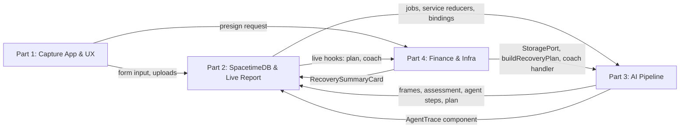

# Pick One of Four Parts

Each person picks one part and owns it through integration and demo. Parts start unassigned. Use [ARCHITECTURE.md](ARCHITECTURE.md) for the design and [CONTRACTS.md](CONTRACTS.md) for interfaces. **This file decides who owns which files.** [AGENTS.md](AGENTS.md) and [WORKFLOW.md](WORKFLOW.md) say how to work inside that ownership.

There is one kind of user: **the person recording**, meaning anyone at the scene who records a 30–60 second video of the damage. They get a damage report, a repair-cost range with line items, safety guidance (911 banner + hazards), and the Recovery Navigator.

| Part | Main responsibility | What you deliver |
|---|---|---|
| **1. Capture App & UX** | Workspace scaffold, capture flow, design system, pitch | The person recording fills in the short form on a phone and uploads footage. The pitch, Devpost and video are ready |
| **2. Realtime Backend & Live Report** | SpacetimeDB module, shared report contracts, the live report page | Every report lives in SpacetimeDB. The same report open on a phone and a laptop updates live, step by step, from upload to finished assessment |
| **3. AI Pipeline** | Worker, frames, Nemotron VL, Nemotron agent + tools, cost model, agent trace (NVIDIA) | Footage becomes validated findings, hazards, a cost estimate, a claim-notice draft and an assessment through a visible multi-step tool loop |
| **4. Recovery Navigator & Infra** | Finance engine, Recovery Navigator UI, coach (PNC); object storage, Vultr, domain, deploy | Each assessed report gets a recovery plan with indicators, forecast, options and what-if. The app runs on the domain over HTTPS |

Pick by preference. Part 1 is frontend and product. Part 2 is backend and realtime, plus the live report page. Part 3 is AI and integrations. Part 4 is fintech logic, UI and infra. Each part owns its own server code, UI folders and tests. Nobody inherits another part's work by default.

## Part 1: Capture App & UX

**Owner: unassigned.**

**Responsibilities**

- Scaffold the pnpm workspace: Node 24, TS strict, Next.js 16 App Router, Tailwind, shadcn/ui, Prettier/ESLint, Vitest, and the `pnpm check` script (typecheck + lint + test across the workspace). Create **empty package skeletons** for every package and app in ARCHITECTURE §3, so that other parts add files rather than create packages.
- Landing page with one clear CTA: **Record damage**.
- `/report/new` (the capture flow): a multi-step mobile form validated with `CreateReportInputSchema`.
  - Steps: hazard → location (geolocation or address) → household → home → insurance → persona picker → record/upload.
  - The 911 banner appears the moment `selfReportedDanger` is true.
  - Calls `create_report`, then `/api/uploads/presign`, then PUT to storage, then `attach_media` and `submit_report`, then redirects to `/report/[id]`.
  - Recording tips (steady pan, good light, 30–60 s, cover roof, walls, interior and water line), plus in-browser capture via `<input type="file" accept="video/*" capture="environment">`.
- Shared UI kit (`components/ui`), the `brand.ts` name/colors, and `format.ts` (cents → `$1,234.56`, relative times). Badges for `synthetic` / `fixture` / `low confidence`.
- Mobile polish. Pitch slides, Devpost text and the demo video edit (with everyone's input).

**Owned files**

~~~text
package.json  pnpm-workspace.yaml  pnpm-lock.yaml  tsconfig.base.json
.prettierrc  eslint.config.mjs  .editorconfig
apps/web/package.json  apps/web/next.config.ts  apps/web/tsconfig.json
apps/web/app/layout.tsx  apps/web/app/globals.css  apps/web/app/page.tsx
apps/web/app/report/new/**
apps/web/components/ui/**
apps/web/components/report/**        # capture-form pieces only
apps/web/lib/brand.ts  apps/web/lib/format.ts
fixtures/ui/**
scripts/smoke-ui.ts
~~~

**First 60 minutes:**
- **Push the scaffold within 30 minutes.** Everyone rebases on it.
- Then build the capture flow against `fixtures/report` JSON (create minimal local copies under `fixtures/ui/` if those aren't there yet).
- Don't wait for live SpacetimeDB. Swap to Part 2's hooks once they land.

**Interfaces**
- *Gives:* the workspace and `pnpm check`; the UI kit; `format.ts`; `brand.ts`; the capture flow that hands off to `/report/[id]`.
- *Receives:* stdb provider/hooks and bindings from Part 2. The presign endpoint and the persona list (`PERSONAS`) from Part 4.

**Done when:** a new visitor on a phone completes the form, records or uploads a real clip, and lands on the live report page on the deployed URL. Danger triggers the 911 banner. Synthetic/fixture badges show wherever they apply. The pitch is rehearsed to 55 seconds.

## Part 2: Realtime Backend & Live Report

**Owner: unassigned.**

**Responsibilities**

- The SpacetimeDB TS module: every table, reducer, auth helper and scheduled reducer in CONTRACTS §5. Publish to Maincloud and regenerate `packages/stdb-bindings`.
- **VERIFY in hour 1** how private rows reach the report owner (views/RLS/filters). Pick that, or the HTTP fallback, and write the decision into CONTRACTS §5.
- Contracts `common.ts`, `report.ts` and `index.ts` (re-exports all domain files, written once).
- `apps/web/lib/stdb`: the connection provider, identity/token persistence, typed hooks (`useReport`, `useFrames`, `useAgentSteps`, `useAssessment`, `useRecoveryPlan`, `useCoachMessages`) and reducer wrappers that convert `u64` ids to strings.
- `/report/[id]` (the live report):
  - a live status timeline (from `report.status` + agent steps);
  - frames with finding captions and labels;
  - the assessment: level, hazards with safety guidance, cost range with line items, summary, recommended actions, claim notice (copy/print);
  - the `needs_more_footage` state, which asks the person recording to re-shoot or add photos;
  - embedded `<AgentTrace>` (Part 3) and `<RecoverySummaryCard>` (Part 4), with a link to `/report/[id]/recovery`;
  - a shareable link, so the same report can be opened on a laptop and updates live there too.
- `scripts/admin-*.ts` adds service identities.

**Owned files**

~~~text
spacetimedb/**
packages/contracts/package.json
packages/contracts/src/common.ts  packages/contracts/src/report.ts  packages/contracts/src/index.ts
packages/stdb-bindings/**            # generated; only Part 2 regenerates
apps/web/lib/stdb/**
apps/web/app/report/[id]/page.tsx
apps/web/components/report-live/**
apps/web/app/api/reports/**          # only if the visibility fallback is chosen
scripts/admin-*.ts
fixtures/report/**
CONTRACTS.md §1, §2, §5
~~~

**First 60 minutes:**
- Publish the contracts (common/report + `index.ts` re-exports, with `assessment.ts`, `agent.ts` and `finance.ts` stubbed as `export {}` if their owners haven't pushed yet).
- Publish a module with `report`, `report_private`, `job`, `service_identity` and the create/attach/submit/claim_job reducers to Maincloud.
- Generate bindings and land the stdb provider/hooks.
- Settle the visibility decision. Hand the worker its service token (out of band, never in git).
- Start the live report page against `fixtures/report` and Part 3's fixture assessment.

**Interfaces**
- *Gives:* contracts; bindings; the hooks every web page uses; service reducers for the worker; the live report page that hosts Part 3's and Part 4's components.
- *Receives:* the FrameFinding/assessment/agent-step JSON shapes and `<AgentTrace>` from Part 3. The RecoveryPlan/coach shapes and `<RecoverySummaryCard>` from Part 4. UI kit and `format.ts` from Part 1.

**Done when:**
- The same report open on a phone and a laptop updates live through every step (frames, trace, assessment, plan) with no refresh.
- Unreadable footage shows `needs_more_footage` with a clear re-shoot prompt.
- Auth rejects non-owner and non-service callers.
- No address, contact or finance data appears in any public table.

## Part 3: AI Pipeline

**Owner: unassigned.**

**Responsibilities**

- `apps/worker`:
  - service connection to SpacetimeDB, job subscription and lease (`claim_job`), handler registry, concurrency limits, graceful shutdown, health log line;
  - the `analyze` handler: download → ffmpeg frames (≤ 8) → thumbnails to storage → `record_frame` → VL per frame → agent loop → `record_assessment` → `build_recovery_plan` tool → `record_recovery_plan` → `complete_job`.
- `packages/vision`: frame extraction, VL prompts with `PROMPT_VERSION`, Zod parse, one retry, unusable handling, and a cache keyed on frame SHA-256.
- `packages/agent`:
  - NIM client (`openai` SDK with `baseURL`) and the bounded tool loop (12 steps, 90 s);
  - native tool calling, or the JSON-action fallback;
  - tools from ARCHITECTURE §6.3 (`get_report_context`, `get_frame_findings`, `reverse_geocode`, `lookup_disaster_declarations`, `get_weather_alerts`, `estimate_repair_cost`, `draft_claim_notice`, `finish`);
  - the dollar-figure post-check, and trace steps for every model and tool turn.
- Life-safety hazard detection (person trapped, fire, gas, collapse, downed lines, interior water), surfaced in the assessment with safety guidance.
- `draft_claim_notice`: an auto-drafted first-notice-of-loss summary from the findings.
- `packages/damage`: the deterministic cost model (CONTRACTS §6), with exact-cents tests.
- Contracts `assessment.ts` and `agent.ts`.
- `<AgentTrace reportId visibility>` component: a live, step-by-step timeline with durations and expandable summaries. This is the "beyond a chatbot" proof for NVIDIA.
- Find 3–4 public-domain disaster clips/images (FEMA/NOAA) for the demo. List them in `fixtures/media/README.md` with source, license and object key.

**Owned files**

~~~text
apps/worker/**                       # incl. src/handlers/index.ts registry
packages/agent/**                    # incl. src/tools/index.ts registry
packages/vision/**
packages/damage/**
packages/contracts/src/assessment.ts  packages/contracts/src/agent.ts
apps/web/components/agent-trace/**
fixtures/assessment/**  fixtures/media/README.md
scripts/smoke-nim.ts
CONTRACTS.md §3, §6, §9
~~~

**First 60 minutes:**
- `scripts/smoke-nim.ts` sends a real public-domain FEMA damage image to Nemotron VL and gets back a **Zod-valid `FrameFinding`**. Save the raw output to `fixtures/assessment/captured/`.
- Verify the exact VL and agent model IDs, image format, rate limits, and whether the agent model handles `tools` reliably. Decide native vs. JSON-action and record it in `status/part3.md` and SOURCES.md.
- Publish `assessment.ts`/`agent.ts` and a fixture `DamageAssessment`, so Parts 1, 2 and 4 can build against it.

**Interfaces**
- *Gives:* assessment and agent-step contracts and fixtures. `<AgentTrace>`. Worker registration points for Part 4's coach handler and `build_recovery_plan` tool (one import line each, added by Part 3 on request).
- *Receives:* bindings, service reducers and the service token from Part 2. `StoragePort` from Part 4 (use a local-disk stub until it lands). `buildRecoveryPlan` and the coach handler from Part 4.

**Done when:**
- A real uploaded clip produces 1–8 frames, validated findings, hazards, a cost estimate with line items, live declarations/alerts lookups, a claim-notice draft and a final assessment, all through the deployed worker in under ~90 s.
- Every step is visible in the trace.
- Unusable footage results in `needs_more_footage`.
- Bad model JSON never crashes a job.
- The summary contains no invented dollar amounts.
- Cost tests pass.

## Part 4: Recovery Navigator & Infra

**Owner: unassigned.**

**Responsibilities**

- `packages/finance` (pure TS, no I/O):
  - at least 3 synthetic personas;
  - `buildRecoveryPlan`, `simulate`, the indicators, payout/gap, options and ranking, and the forecast (CONTRACTS §7), with exact-cents tests;
  - `coach/handler.ts` (job `coach`: Nemotron answers grounded in the plan JSON + chat history, short, with disclaimers) and `tools/buildRecoveryPlan.ts` (an `AgentTool` for Part 3 to register);
  - a coach-summary prompt to fill `coachSummary`.
- Contracts `finance.ts`.
- `/report/[id]/recovery` (the PNC Navigator):
  - the gap headline (repair vs. expected payout), with payout notes such as the flood exclusion;
  - 5 indicator cards with good/watch/risk;
  - a 90-day forecast chart (Recharts) with obligation and payout markers and the shortfall day;
  - a ranked options table with the recommended mix;
  - the **what-if simulator** (sliders: repair case, payout delay, deductible, income loss, and funding mix), recomputed client-side on every change;
  - coach chat via `ask_coach`.
- `<RecoverySummaryCard>` for the live report page.
- `packages/storage`: `StoragePort` over Vultr Object Storage (S3 SDK), plus a local-disk fallback.
- API routes (CONTRACTS §8): `/api/uploads/presign`, `/api/media/[...key]` (owner-only), `/api/health`.
- Infra:
  - Vultr VM, Docker Compose (`caddy`, `web`, `worker`), Dockerfiles, Caddyfile, `infra/deploy.sh`;
  - bucket + CORS;
  - GoDaddy Registry domain + DNS;
  - `.env.example` (CONTRACTS §10), `docs/DEPLOYMENT.md`.
- Redeploy after merges to `main`. Keep the spend ledger in `status/part4.md`.

**Owned files**

~~~text
packages/finance/**                  # engine, personas, simulator, coach handler, build_recovery_plan tool
packages/storage/**
packages/contracts/src/finance.ts
apps/web/app/report/[id]/recovery/**
apps/web/components/finance/**       # incl. RecoverySummaryCard
apps/web/app/api/uploads/**  apps/web/app/api/media/**  apps/web/app/api/health/**
infra/**  compose.yaml  Dockerfile*  .dockerignore  .env.example
docs/DEPLOYMENT.md
fixtures/finance/**
CONTRACTS.md §4, §7, §8, §10
~~~

**First 60 minutes:**
- Redeem the Vultr credit. Create the VM and bucket and get presigned PUT working from a browser (CORS).
- Order the domain (code `MLHUTD84`).
- Deploy Part 1's scaffold behind Caddy, using the provider hostname until DNS resolves.
- Publish `finance.ts`, the personas, and `buildRecoveryPlan` running against Part 3's fixture assessment (or a local fixture in `fixtures/finance/`).

**Interfaces**
- *Gives:* `StoragePort` and presign/media/health routes. `buildRecoveryPlan`, `simulate`, `PERSONAS`, `getPersona`. The coach handler and the plan tool for Part 3 to register. `<RecoverySummaryCard>`. A deployed URL and env var names.
- *Receives:* assessment fixtures and the shape from Part 3. Bindings/hooks plus `ask_coach` and `record_recovery_plan` from Part 2. UI kit and `format.ts` from Part 1.

**Done when:**
- Every assessed live report has a recovery plan.
- The Navigator shows at least 3 indicators, the forecast, options and the recommended mix.
- The what-if simulator updates instantly.
- The coach answers from the plan.
- Flood-without-flood-coverage is handled with the right note.
- Finance tests pass with exact cents.
- The app runs on the domain over HTTPS. Restarting the containers loses nothing.
- Spend stays within credits.

## How the four parts connect

1. Part 1 pushes the scaffold. Part 2 pushes contracts, the module and bindings. Parts 3 and 4 prove NIM and storage independently.
2. Part 1's capture flow writes through Part 2's reducers and Part 4's presign, then hands off to Part 2's live report page. Part 3's worker picks up the job.
3. Part 3 writes frames, trace steps, the assessment and the plan (via Part 4's tool). The live report page updates step by step on every open screen.
4. The person recording opens Part 4's Navigator from the report page.

## Shared file rules

- Every path has exactly one owner (lists above). STATUS.md, WORKFLOW.md, AGENTS.md, IDEA.md, ARCHITECTURE.md, README.md and SOURCES.md belong to the **team lead**. Others propose edits by PR, and changes need everyone's ack. Each person appends only to their own `status/partN.md`.
- CONTRACTS.md is edited section by section by the section's owner (§0 table). Contract changes are additive unless all four agree.
- Root config and the lockfile belong to Part 1. Add dependencies only to your own package with `pnpm --filter`. If the lockfile conflicts, take main's version and rerun `pnpm install`.
- `packages/stdb-bindings/**` is generated. Only Part 2 regenerates it, after every module publish. Everyone else takes main's copy on conflict.
- Registries (`apps/worker/src/handlers/index.ts`, `packages/agent/src/tools/index.ts`) belong to Part 3 and list one import per line. Part 4 requests its two lines.
- Cross-part UI is composed through exported components (`<AgentTrace>`, `<RecoverySummaryCard>`). The host page owner (Part 2, for `/report/[id]`) places them; the component owner controls what's inside.
- Until upstream code lands, build against labeled fixtures in your own `fixtures/<domain>/`. Never ship a fixture as live.
- If you finish early, help the bottleneck **by agreement**, in files the owner hands you. Note the handoff in both status files.

## Checkpoints

Elapsed time is from kickoff. Clock times assume hacking starts around Sat 12–1 PM; confirm against the Hackerpack.

| Target | Exit condition |
|---|---|
| **0:30** | Scaffold on `main`. Everyone rebased |
| **1:00** | Contracts + module on Maincloud + bindings. A real Nemotron VL call returns a valid `FrameFinding`. Presign PUT works on Vultr. Domain ordered. Visibility decision recorded |
| **1–4 h** | **Vertical slice:** capture → upload → job → worker → frames → findings → assessment (fixture cost OK) → live report page updating on phone and laptop. Deployed on the VM |
| **4–8 h** | Agent tool loop with trace. Real cost model. OpenFEMA/NWS/geo tools. Hazards + safety guidance. Claim-notice draft. Recovery plan + Navigator v1 |
| **Sat 11:00 PM** | **Initial Devpost submitted** (title, draft description, team, repo link). Part 1 owns it |
| **8–14 h** | What-if simulator, coach, `needs_more_footage` re-shoot flow, domain + HTTPS, smoke checklist green |
| **14–20 h** | Polish, fallbacks, first full demo recording kept as a backup |
| **Sun 10:30 AM** | **Internal code freeze.** Only demo-blocking fixes after this |
| **Sun 12:00 PM** | **Final Devpost**: video, sponsor tracks, AI-tool disclosure |
| **Sun 1–4 PM** | Judging. Deployed demo + recorded backup ready |

## Cut list if behind (cut from the top)

1. Spanish strings, before/after slider, claim-notice print view.
2. Coach chat. Keep the static `coachSummary`.
3. NWS alerts tool. Keep OpenFEMA + geocode.
4. Funding-mix sliders. Keep the repair-case and payout-delay sliders.
5. Multi-image VL batching. Use one call per frame.

**Never cut:** the real VL call on real footage, the deterministic cost model, hazard detection with the 911 banner, live SpacetimeDB updates on both screens, the visible agent trace, at least 3 indicators + forecast + one what-if control, and synthetic labeling.

## Focused validation (each part owns its checks)

Required before recording:

- **P2:** auth rejects non-owner/non-service callers; public tables contain no address/contact/finance; status transitions (including `needs_more_footage`) are correct; two open screens stay in sync.
- **P3:** Zod parse of captured real outputs; invalid JSON → retry → unusable; step cap; exact-cents cost on fixed inputs; dollar post-check; hazard flags only at confidence ≥ 0.5.
- **P4:** indicator thresholds; flood exclusion; forecast on a fixed persona; option ranking; integer cents throughout; simulator < 20 ms; presign rejects wrong type/size; `/api/media` rejects non-owners.
- **P1:** form schema; the full capture journey on mobile Safari + Chrome; badges and the 911 banner visible.
- **All:** one end-to-end run on the deployed domain using the [docs/DEMO.md](docs/DEMO.md) checklist. Skip exhaustive UI snapshots and unrelated edge cases.
