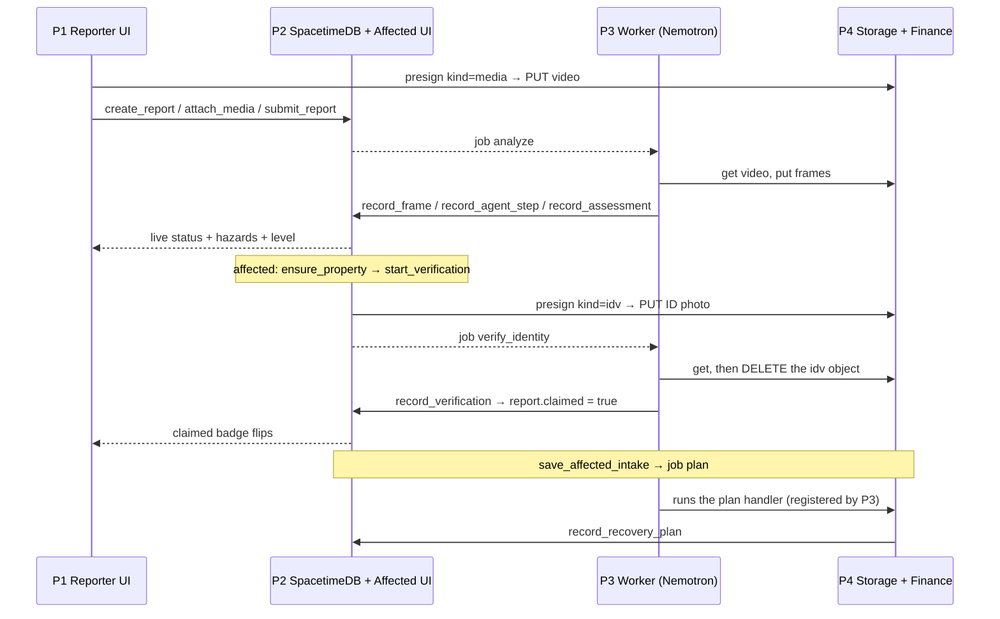

# Implementation Plan: Four Parts, Screen by Screen

Each person picks one part and owns it through integration and demo. Names are unassigned. Product behavior comes from [IDEA.md](IDEA.md), design from [ARCHITECTURE.md](ARCHITECTURE.md), and interfaces from [CONTRACTS.md](CONTRACTS.md). **This file is the authority for file ownership, task order and who sees what.** Every path in the repo has exactly one owner.

There are two views:

- **Reporter view:** anyone at the scene films a property and submits it. They see safety and status only, plus a map of their own submissions.
- **Affected-person view:** the person whose property it is enters their address, verifies with an ID photo, and then receives the full report, an area map and the Recovery Navigator.

## 1. The four parts

| Part | Main responsibility | What you deliver |
|---|---|---|
| **P1. Reporter View & Shared UI** | Landing, capture flow, reporter status page, "My submissions" map, plus the shared UI kit, map and safety components | Anyone can film and submit a property in under 2 minutes on a phone and watch the status live |
| **P2. Backend & Affected View** | SpacetimeDB module (all tables and reducers), property matching, geocoding, and the affected-person flow (address → verify → property → report page) | A verified affected person sees exactly their property's reports and nothing else; everything updates live |
| **P3. AI Pipeline (Nemotron)** | Worker, frames, Nemotron VL damage findings, the Nemotron agent and tools, ID-document reading, plus the `<DamageReport>` and `<AgentTrace>` components | Real footage becomes a validated assessment with a visible trace; an ID photo becomes a deterministic verified/failed result |
| **P4. Recovery Navigator & Infra** | Finance engine, intake, Navigator page, what-if, coach, plus storage, uploads, Vultr deployment and the domain | A verified affected person gets a recovery plan with a working what-if simulator, all on the live HTTPS domain |

Pick by preference: P1 is frontend/mobile UX, P2 is backend/realtime and the gated UX, P3 is AI and agents, P4 is fintech logic plus infra.

## 2. Views and screens matrix

| Route | View | Owner | Who can open it | What it shows | Data source |
|---|---|---|---|---|---|
| `/` | both | P1 | anyone | Two CTAs: **Report damage** and **I've been affected**; one-line pitch | static, `lib/brand.ts` |
| `/report/new` | reporter | P1 | anyone | Steps: hazard → GPS → suggested address (confirm/edit) → "Is anyone in danger right now?" + notes → "Is this your property?" → upload (video ≤ 120 s or ≤ 8 photos) → submit | `/api/geocode` (P2), `/api/uploads/presign` (P4), reducers `create_report`, `attach_media`, `submit_report` (P2) |
| `/report/[id]` | reporter | P1 | the reporter identity of that report | Live status timeline; life-safety hazards + `<Banner911>`; overall damage level; claimed badge; "The resident can find this at [site] → I've been affected"; re-shoot prompt if `needs_more_footage`. **No cost, frames, claim draft or finance** | `report` (public), own `agent_step` rows of kind `pipeline`, `components/safety` |
| `/reporter` | reporter | P1 | the current browser identity | **"My submissions":** `<PinMap>` with only this identity's reports (color = damage level, ✓ = claimed) plus a list | `report` filtered `reporter == me`, own `report_private` for lat/lng |
| `/affected/start` | affected | P2 | anyone | Address entry → geocode → choose the normalized match → find or create the property | `/api/geocode`, reducer `ensure_property` |
| `/affected/verify` | affected | P2 | anyone with a chosen property | Choose doc type → camera capture → upload → live verification status → verified / failed (reason) / "Try another document" | reducers `start_verification`, `submit_verification`; own `verification` row; `/api/uploads/presign` `kind=idv` |
| `/affected/property/[propertyId]` | affected | P2 | **verified** identities get the full page; unverified see area cells + alerts only | Report list for this property (photo, level, hazard, time); `<CellMap>` (own pin + aggregated cells, 72 h / 1 km); NWS alert + FEMA declaration banner; "Film it yourself" when there are none | `report` by `property_id`, `area_cell_summary`, latest `assessment` |
| `/affected/report/[id]` | affected | P2 shell; embeds P3 and P4 | verified identities for the report's property | `<DamageReport>` (frames, findings, hazards + guidance, cost lines, claim draft) and `<AgentTrace mode="full">` from P3; `<RecoverySummaryCard>` from P4 | `frame`, `assessment`, `agent_step`, `recovery_plan` |
| `/affected/property/[propertyId]/recovery` | affected | P4 | verified identities for that property | Intake (household, tenure, sqft/stories, insurance, persona) → plan → indicators, gap, forecast chart, ranked options, what-if, coach; report picker (default = most severe assessed) | `affected_profile`, `recovery_plan`, `coach_message`, `packages/finance` (`simulate` in the browser) |
| `/api/geocode` | both | P2 | anyone (rate-limited) | `?q=` → US Census forward geocode; `?lat&lng` → Nominatim reverse. Returns `NormalizedAddress[]` | external |
| `/api/uploads/presign` | both | P4 | the report's reporter (`kind=media`) or the verification owner (`kind=idv`) | Presigned PUT | object storage |
| `/api/media/[...key]` | affected | P4 | verified identities of the property only; `idv/` keys are **never** served | 302 to a presigned GET | object storage |
| `/api/health` | — | P4 | anyone | web / stdb / storage status | — |

## 3. Who sees what

| Data item | Reporter | Affected, **unverified** | Affected, **verified** for that property |
|---|---|---|---|
| Processing status timeline | ✅ own reports | ❌ | ✅ |
| 911 banner + life-safety hazards | ✅ (they're on scene) | ❌ | ✅ + guidance tailored to the household |
| Overall damage level | ✅ | ❌ (only as a map cell's worst level) | ✅ |
| Frames + findings | ❌ | ❌ | ✅ |
| Cost range + line items | ❌ | ❌ | ✅ |
| Claim-notice draft | ❌ | ❌ | ✅ |
| Agent trace | `pipeline` steps only (as the status timeline) | ❌ | ✅ full |
| Exact address + coordinates | ✅ own submissions only | own entered address only | ✅ |
| Reporter notes ("water still rising") | ✅ own | ❌ | ✅ (the reporter's identity is never shown) |
| Map pins | ✅ `<PinMap>`: own submissions only | ❌ | own property pin only |
| Area cells (aggregated nearby reports) | ❌ | ✅ | ✅ |
| NWS alerts / FEMA declaration | ❌ | ✅ | ✅ |
| Finances / Recovery Navigator | ❌ never | ❌ | ✅ own intake only (never another verified identity's plan) |
| Coach chat | ❌ | ❌ | ✅ own |
| "Claimed" badge | ✅ yes/no only, no name | — | — |

## 4. Decisions and FAQ

| Question | Decision |
|---|---|
| Is there a map? Whose side? | **Both sides, different data.** Reporter `/reporter`: `<PinMap>` of only their own submissions, colored by damage level, with claimed badges. Affected `/affected/property/[id]`: `<CellMap>` with their own property pin plus ~250 m aggregated cells (count + worst level, last 72 h, 1 km radius) and an alerts/declaration banner. Nobody sees other people's individual pins |
| Map library | Leaflet + OSM tiles with attribution. One shared wrapper in `components/map/**` (P1) exports `<PinMap>` and `<CellMap>` |
| Several people film the same house | All reports attach to the same `property` (same normalized address, or within 30 m). The affected person sees all of them. The Navigator defaults to the most severe assessed report and offers a picker |
| No reports for my address yet | The verified view shows "No reports yet", the area map, and **Film it yourself** → `/report/new?self=1&address=…` |
| Verification fails | Reason shown (`address_mismatch`, `unreadable`, `not_an_id`, `expired`, `rate_limited`) plus "Try another document" (utility bill or insurance declarations page). Max 3 attempts per hour. Until verified: area cells + alerts only |
| Self-report path | "Is this your property?" = yes → after submit, go to `/affected/start` with the address prefilled. **ID verification is still required** |
| Who answers the finance and insurance questions? | The verified affected person, on the recovery page. The reporter is never asked |
| ID images | Uploaded to `idv/<verificationId>/` and read once by the `verify_identity` job, then **deleted immediately**. Only `name_on_doc`, the result and timestamps are kept. The demo uses specimen IDs or a teammate's own ID with consent |
| Home size for the cost estimate | `analyze` uses defaults (1800 sqft, 1 story, own), labeled "assumed home size". The `plan` job re-runs the cost model with intake values inside the RecoveryPlan |
| Triage or responder dashboard? | **No.** Out of scope |
| Accounts? | None. Anonymous SpacetimeDB identities stored in the browser. Verification is attached to the identity |

---

## P1: Reporter View & Shared UI

**Owner: unassigned.** Make filming and submitting someone's property fast and calm on a phone, keep the reporter informed with safety and status only, and own the shared look (UI kit, map and safety components). Also own the root scaffold so the others can start within 30 minutes.

| # | Deliverable | Files | Depends on | Acceptance check |
|---|---|---|---|---|
| T1.1 | Monorepo scaffold: pnpm workspace, Next.js 16, Tailwind + shadcn/ui, Prettier/ESLint, `pnpm check`, empty packages from ARCHITECTURE §3 | root configs, `apps/web` config, `packages/*/package.json` stubs | none | Fresh clone → `pnpm install && pnpm check && pnpm dev` works; pushed within 30 min |
| T1.2 | `lib/brand.ts`, `lib/format.ts` (cents → `$1,234.56`, relative time, damage-level labels and colors) + tests | `apps/web/lib/brand.ts`, `lib/format.ts` | T1.1 | Tests pass; colors: none grey, affected yellow, minor orange, major red, destroyed black |
| T1.3 | Layout + landing `/` with the two CTAs; mobile-first, 44 px tap targets | `app/layout.tsx`, `app/page.tsx`, `globals.css` | T1.1 | Both CTAs route correctly on a phone |
| T1.4 | Safety components `<Banner911>`, `<HazardList flags>`, guidance text per `LifeSafetyFlag` (+ vulnerability lines) | `components/safety/**` | T2.1 (local fixture until then) | `/dev/safety` preview; every flag has text |
| T1.5 | Map wrapper `<PinMap pins>` and `<CellMap center cells ownPin>` (Leaflet, SSR-safe dynamic import, OSM attribution) | `components/map/**` | T1.2 | Fixture pins and cells render on mobile; no SSR errors |
| T1.6 | Capture steps 1–2: hazard picker; GPS → `/api/geocode?lat&lng` → confirm/edit address | `app/report/new/**`, `components/report/**` | T2.6 (`fixtures/property/addresses.json` until then) | Denied GPS falls back to manual entry |
| T1.7 | Capture steps 3–4: danger question (yes → `<Banner911>` immediately) + notes; "Is this your property?" | same | T1.4 | The banner shows before any upload |
| T1.8 | Capture step 5: video (≤ 120 s, ≤ 200 MB) or ≤ 8 photos; client SHA-256; presign → PUT with progress → `attach_media` → `submit_report` | same | T4.3, T2.3 | Real upload; the report is `queued` |
| T1.9 | Self-report redirect → `/affected/start?address=…&self=1` | same | T2.7 | Address prefilled on P2's page |
| T1.10 | Reporter status `/report/[id]`: live timeline from `report.status` + `<AgentTrace mode="pipeline">`; hazards + `<Banner911>`; level; claimed badge; how-the-resident-finds-it note | `app/report/[id]/**` | T2.4, T3.11 | The timeline advances without refresh on a real job |
| T1.11 | `needs_more_footage` / `failed` states: re-shoot or add photos → `attach_media` + `submit_report`; "Try again" | same | T2.3 | Resubmitting the same report works |
| T1.12 | "My submissions" `/reporter`: `<PinMap>` + list of own reports; claimed badge live | `app/reporter/**` | T1.5, T2.4 | Verification on another device flips the badge live |
| T1.13 | Empty, offline and error states; upload retry on a flaky network | P1 files | — | Airplane-mode test shows a clear message |
| T1.14 | Visual polish, copy, Spanish strings (stretch) | P1 files | — | Team review |
| T1.15 | Pitch slides, Devpost text, demo video edit | outside code | docs/DEMO.md | Submitted by the deadlines |

**Owned files**

```text
package.json pnpm-workspace.yaml pnpm-lock.yaml tsconfig.base.json .prettierrc eslint.config.mjs .editorconfig
apps/web/package.json apps/web/next.config.ts apps/web/tsconfig.json
apps/web/app/layout.tsx apps/web/app/globals.css apps/web/app/page.tsx
apps/web/app/report/**             # /report/new and /report/[id] (reporter status)
apps/web/app/reporter/**           # My submissions
apps/web/app/dev/**                # dev-only previews
apps/web/components/ui/** apps/web/components/report/** apps/web/components/map/** apps/web/components/safety/**
apps/web/lib/brand.ts apps/web/lib/format.ts
fixtures/ui/** scripts/smoke-ui.ts
```

**First 60 minutes:** T1.1 by minute 30; then T1.2 and T1.3; export `<PinMap>`/`<CellMap>`/`<Banner911>` stubs so P2 and P3 can import them.

**Interfaces.** *Gives:* `<PinMap>`, `<CellMap>`, `<Banner911>`, `<HazardList>`, `formatCents`, `damageLevelColor`, the UI kit. *Receives:* `useTable`/`useReducer` and `createReport`/`attachMedia`/`submitReport` (P2), `/api/geocode` (P2), `/api/uploads/presign` (P4), `<AgentTrace>` and the `pipeline` step names (P3).

**Done when:** on a phone, a stranger submits a real video in under 2 minutes; the status page advances live to `assessed` with hazards and level; `/reporter` shows the pin, which flips to claimed when the resident verifies on another device.

---

## P2: Backend & Affected View

**Owner: unassigned.** Own every table and reducer, the rule that only a verified affected person sees a property's details, address normalization and geocoding, and the affected flow from address to verified property to report page.

| # | Deliverable | Files | Depends on | Acceptance check |
|---|---|---|---|---|
| T2.1 | Contracts `common.ts`, `report.ts`, `property.ts`, `index.ts` (re-exports every domain file) | `packages/contracts/**` (those files) | T1.1 | Builds; others import types |
| T2.2 | `packages/address`: `normalizeAddress()`, `haversineM()`, `cellId(lat,lng)` (~250 m), `streetSimilarity()` + tests | `packages/address/**` | T2.1 | Tests: STREET→ST, unit stripping, 30 m match, stable cells |
| T2.3 | Module v1: tables `property`, `property_private`, `report`, `report_private`, `media_asset`, `frame`, `assessment`, `agent_step`, `job`, `service_identity`; reducers `init`, `admin_add_service`, `ensure_property`, `create_report` (upserts property), `attach_media`, `submit_report`, `claim_job`, `record_frame`, `record_agent_step`, `record_assessment`, `complete_job`, scheduled `requeue_expired_jobs` | `spacetimedb/**` | T2.1, T2.2 | Published to Maincloud; `spacetime call` smoke works |
| T2.4 | Bindings + web provider: `pnpm stdb:generate`; `apps/web/lib/stdb` (connection, identity persistence, typed `useTable`, `useReducer`, u64 ↔ string) | `packages/stdb-bindings/**`, `apps/web/lib/stdb/**` | T2.3 | P1 renders live `report` rows |
| T2.5 | **VERIFY visibility**: private rows readable only by the reporter (own) or verified identities (views on `ctx.sender` joined to `verification`), or the HTTP fallback. Write the result in CONTRACTS §5 | `spacetimedb/**`, maybe `app/api/private/**` | T2.3 | Test: unverified can't read `frame`/`assessment`; verified can |
| T2.6 | `/api/geocode`: Census forward `?q`, Nominatim reverse `?lat&lng` (≤ 1 req/s, generic User-Agent), normalized output, 10 min cache | `app/api/geocode/**` | T2.2 | A real Texas address and coordinate both return a NormalizedAddress |
| T2.7 | `/affected/start`: address → geocode → pick → `ensure_property`; `?address=` prefill | `app/affected/start/**`, `components/affected/**` | T2.6 | The self-report prefill works |
| T2.8 | Verification backend: `verification` table; `start_verification` (3/h), `submit_verification` (enqueues `verify_identity`), `record_verification` (service; ok → `report.claimed = true` for the property) | `spacetimedb/**` | T2.3 | Rate limit enforced; `claimed` flips |
| T2.9 | `/affected/verify`: doc type, camera capture, presign `kind=idv` → PUT → `submit_verification`; live status; reasons; another document | `app/affected/verify/**` | T2.8, T4.3, T3.9 (`fixtures/verification/result-*.json` until then) | Verified → redirect to the property page |
| T2.10 | `area_cell_summary` maintained on `record_assessment` + scheduled 5-min recompute of the 72 h window | `spacetimedb/**` | T2.3 | Cells expire after 72 h (clock-injected test) |
| T2.11 | `/affected/property/[propertyId]`: verified gate; report list; `<CellMap>` with own pin + cells within 1 km; alerts/declaration banner from the latest assessment; "Film it yourself" | `app/affected/property/[propertyId]/page.tsx` | T2.10, T1.5 | Unverified sees cells + alerts only |
| T2.12 | `/affected/report/[id]` shell: verified gate; embeds `<DamageReport>`, `<AgentTrace mode="full">`, `<RecoverySummaryCard>` | `app/affected/report/**` | T3.11, T3.12, T4.9 (placeholders until then) | Renders from a fixture and from a live report |
| T2.13 | Finance-side tables + reducers: `affected_profile`, `recovery_plan`, `coach_message`; `save_affected_intake` (enqueues `plan`), `record_recovery_plan`, `ask_coach`, `record_coach_reply` | `spacetimedb/**` | T4.4 (`AffectedIntake`) | P4 saves intake and reads the plan |
| T2.14 | Admin scripts: create the worker identity, `admin_add_service`, republish/wipe helper | `scripts/admin-*.ts` | T2.3 | The worker connects as a service |
| T2.15 | Module tests: auth on every reducer, status transitions, rate limit, matching, gating | `spacetimedb/**` tests | all above | `pnpm check` green |

**Owned files**

```text
spacetimedb/**
packages/contracts/src/common.ts packages/contracts/src/report.ts packages/contracts/src/property.ts packages/contracts/src/index.ts packages/contracts/package.json
packages/stdb-bindings/**           # generated
packages/address/**
apps/web/lib/stdb/**
apps/web/app/api/geocode/**
apps/web/app/api/private/**         # only if the visibility fallback is used
apps/web/app/affected/start/** apps/web/app/affected/verify/**
apps/web/app/affected/property/[propertyId]/page.tsx   # everything under [propertyId] except recovery/**
apps/web/app/affected/report/**
apps/web/components/affected/**
scripts/admin-*.ts fixtures/report/** fixtures/property/**
CONTRACTS.md §1 §2 §5
```

**First 60 minutes:** T2.1 → minimal T2.3 published → T2.4 bindings + hooks pushed → start the T2.5 VERIFY.

**Interfaces.** *Gives:* every reducer above, `useTable`/`useReducer`, `useVerifiedFor(propertyId)`, `normalizeAddress`, `cellId`, `/api/geocode`. *Receives:* worker service-reducer calls and the `verify_identity` result (P3), the `AffectedIntake`/`RecoveryPlan` schemas (P4), `<PinMap>`/`<CellMap>`/`<Banner911>` (P1), `<DamageReport>`/`<AgentTrace>` (P3), `<RecoverySummaryCard>` (P4).

**Done when:** on two devices, an affected person enters the address of a report just filed, verifies with a specimen ID, and sees that report and the area cells. A different, unverified identity sees no details. The reporter's badge flips live.

---

## P3: AI Pipeline (Nemotron)

**Owner: unassigned.** Turn real footage into a validated damage assessment, and an ID photo into a deterministic verified/failed result, through Nemotron VL and a multi-step Nemotron agent with tools, every step visible in the trace.

| # | Deliverable | Files | Depends on | Acceptance check |
|---|---|---|---|---|
| T3.1 | NIM client (`openai` SDK, `NVIDIA_BASE_URL`), 429 backoff, `USE_FIXTURES`; **VERIFY** model IDs, image input format, tool calling | `packages/agent/src/nim.ts`, `scripts/smoke-nim.ts` | none | The smoke script gets replies from both models |
| T3.2 | Contracts `assessment.ts`, `agent.ts`, `verification.ts` | `packages/contracts/src/…` | T2.1 | Compiles |
| T3.3 | VL damage prompt + `FrameFinding` parsing; retry once, then unusable; capture real outputs as fixtures | `packages/vision/**`, `fixtures/assessment/captured/**` | T3.1 | A public-domain FEMA image → valid FrameFinding |
| T3.4 | Worker host: service identity, subscribe to queued jobs, `claim_job` lease, registry (one import per line), `ctx.step()` → `record_agent_step` | `apps/worker/**` | T2.3, T2.14 | A job is claimed exactly once; steps appear live |
| T3.5 | Frames: ffmpeg-static scene change + fill, cap 8, 768 px; thumbnails → storage; `record_frame` | `packages/vision/src/frames.ts` | T4.2 | 60 s clip → ≤ 8 frames stored |
| T3.6 | `estimateRepairCost()` (CONTRACTS cost model) + exact-cents tests | `packages/damage/**` | T3.2 | Fixed inputs → exact cents |
| T3.7 | Tools: `get_report_context`, `get_frame_findings`, `reverse_geocode` (FCC), `lookup_disaster_declarations` (OpenFEMA), `get_weather_alerts` (NWS), `draft_claim_notice` | `packages/agent/src/tools/**` | T3.1 | A unit test per tool with a recorded response |
| T3.8 | Agent loop (≤ 12 steps, 90 s, JSON-action fallback), merge code-computed fields, `$` post-check, `record_assessment` | `packages/agent/src/loop.ts`, `apps/worker/src/handlers/analyze.ts` | T3.3–T3.7 | Real clip → `assessed` with ≥ 6 trace steps |
| T3.9 | `verify_identity`: fetch the `idv/` object → VL extracts `IdDocumentFields` → deterministic match (`normalizeAddress` + rule) → **delete the object** → `record_verification` | `apps/worker/src/handlers/verifyIdentity.ts`, `packages/vision/src/idDocument.ts` | T2.2, T2.8 | Specimen with a matching address → verified; wrong address → `address_mismatch`; the object is deleted |
| T3.10 | ID fixtures: specimen/sample IDs and synthetic utility bills only | `fixtures/verification/**` | — | No real person's ID in the repo |
| T3.11 | `<AgentTrace reportId mode="pipeline"|"full">` (live steps, durations, tool names) | `components/agent-trace/**` | T2.4 | P1 uses `pipeline`, P2 uses `full` |
| T3.12 | `<DamageReport reportId>`: frames with finding overlays, `<HazardList>`, cost lines ("assumed home size"), claim draft copy/print | `components/damage-report/**` | T1.4, T2.5 | Renders fixture and live data |
| T3.13 | Register P4's `plan`/`coach` handlers and `build_recovery_plan` tool (one line each) | `apps/worker/src/handlers/index.ts`, `packages/agent/src/tools/index.ts` | T4.8, T4.12 | The `plan` job runs |
| T3.14 | VL cache by frame SHA-256; concurrency limits | `packages/vision/**` | T3.3 | A demo re-run makes no new VL calls |
| T3.15 | Tests: parsers on captured outputs, step cap, retry path, `$` check, match rule, deletion | P3 packages | — | `pnpm check` green |

**Owned files**

```text
apps/worker/**                      # host, registry, analyze + verifyIdentity handlers
packages/agent/** packages/vision/** packages/damage/**
packages/contracts/src/assessment.ts packages/contracts/src/agent.ts packages/contracts/src/verification.ts
apps/web/components/agent-trace/** apps/web/components/damage-report/**
fixtures/assessment/** fixtures/verification/** fixtures/media/README.md
scripts/smoke-nim.ts
CONTRACTS.md: assessment/agent/verification, cost model, worker interfaces sections
```

**First 60 minutes:** T3.1 + T3.3 on a FEMA public-domain image; post the verified model IDs and whether native tool calling works.

**Interfaces.** *Gives:* `<AgentTrace>`, `<DamageReport>`, `pipeline` step names (`uploaded`, `extract_frames`, `analyze_frames`, `estimate_cost`, `check_declarations`, `finalize`), the `verify_identity` result, and `estimateRepairCost()` for P4. *Receives:* service reducers and the `job` table (P2), `normalizeAddress` (P2), `StoragePort` (P4), P4's handlers and tool, `<HazardList>` (P1).

**Done when:** a real 60 s clip reaches `assessed` in under 90 s with a ≥ 6-step trace and no invented dollar figures; a specimen ID verifies and a mismatched one fails with the right reason; ID objects are deleted.

---

## P4: Recovery Navigator & Infra

**Owner: unassigned.** Give the verified affected person a clear financial picture and a next move (PNC), and run everything on Vultr behind the GoDaddy domain.

| # | Deliverable | Files | Depends on | Acceptance check |
|---|---|---|---|---|
| T4.1 | Vultr VM + Docker + Caddy; Object Storage bucket + CORS; domain (code `MLHUTD84`) → A record | `infra/**`, `docs/DEPLOYMENT.md` | none | `https://<domain>/api/health` serves P1's scaffold |
| T4.2 | `packages/storage` `StoragePort` (presignPut/Get, get/put/delete, ping) | `packages/storage/**` | T4.1 | Round-trip test against the bucket |
| T4.3 | `/api/uploads/presign` (`kind=media`/`idv`, limits, key layout), `/api/media/[...key]` (verified only; never `idv/`), `/api/health` | `app/api/uploads/**`, `api/media/**`, `api/health/**` | T4.2, T2.5 | Oversize/wrong type rejected; `idv/` → 403 |
| T4.4 | Contracts `finance.ts` incl. `AffectedIntake`, `Household` | `packages/contracts/src/finance.ts` | T2.1 | Compiles |
| T4.5 | ≥ 3 synthetic personas + `getPersona` | `packages/finance/src/personas/**` | T4.4 | Each validates |
| T4.6 | Engine: payout/gap, 5 indicators, options, recommended mix, 90-day forecast, `buildRecoveryPlan()`; re-run `estimateRepairCost` with the intake home size | `packages/finance/src/**` | T3.6 (`fixtures/assessment` until then) | Exact-cents tests; flood exclusion |
| T4.7 | `simulate()` pure, < 20 ms | `packages/finance/src/simulate.ts` | T4.6 | Benchmark test |
| T4.8 | `plan` job handler + `build_recovery_plan` tool (exported for P3 to register) → `record_recovery_plan`; `coachSummary` via NIM | `packages/finance/src/jobs/**` | T3.4, T2.13 | Saving intake produces a plan live |
| T4.9 | `<RecoverySummaryCard>` (gap, worst indicator, CTA) | `components/finance/**` | T4.6 | Renders inside P2's report page |
| T4.10 | Recovery page: intake → `save_affected_intake`; report picker; indicators; gap; forecast (Recharts); ranked options | `app/affected/property/[propertyId]/recovery/**` | T2.13 | Verified only; works on a phone |
| T4.11 | What-if panel: repair case, payout delay, deductible, income loss, funding mix → `simulate()` | same + `components/finance/**` | T4.7 | The chart redraws instantly |
| T4.12 | Coach: chat UI → `ask_coach`; `coach` handler grounded in the plan JSON | same + `packages/finance/src/coach/**` | T3.1 | Answers use plan figures only |
| T4.13 | `.env.example`, `infra/deploy.sh`, restart policies, cost ledger in `status/part4.md` | `infra/**`, `.env.example` | T4.1 | Redeploy after a merge < 5 min |
| T4.14 | Tests: indicators, forecast, ranking, integer cents, presign limits, media gating | P4 packages | — | `pnpm check` green |

**Owned files**

```text
packages/finance/** packages/storage/**
packages/contracts/src/finance.ts
apps/web/app/affected/property/[propertyId]/recovery/**
apps/web/components/finance/**
apps/web/app/api/uploads/** apps/web/app/api/media/** apps/web/app/api/health/**
infra/** compose.yaml Dockerfile* .dockerignore .env.example docs/DEPLOYMENT.md
fixtures/finance/**
CONTRACTS.md: finance, finance formulas, HTTP API, env sections
```

**First 60 minutes:** T4.1 started (VM, bucket, domain); T4.2 + T4.3 presign working; personas + `buildRecoveryPlan` against a fixture assessment.

**Interfaces.** *Gives:* `StoragePort`, presign/media/health routes, `buildRecoveryPlan`, `simulate`, `getPersona`, `plan`/`coach` handlers, the `build_recovery_plan` tool, `<RecoverySummaryCard>`, the deployed URL and env. *Receives:* the intake reducers and `recovery_plan` table (P2), `estimateRepairCost` and the registries (P3), the scaffold (P1).

**Done when:** a verified affected person completes intake on a phone and sees 5 indicators, the gap, a forecast and ranked options; a what-if slider redraws instantly; the coach answers from the plan; everything runs on the HTTPS domain.

---

## 5. How the parts connect



| Blocked task | Unblocked by | Fixture until then |
|---|---|---|
| T1.6 address step | T2.6 `/api/geocode` | `fixtures/property/addresses.json` |
| T1.8 upload | T4.3 presign + T2.3 reducers | dev-only mock presign |
| T1.10 status page | T2.4 hooks + T3.11 trace | `fixtures/report/status-sequence.json` |
| T2.9 verify page | T3.9 handler | `fixtures/verification/result-ok.json`, `result-mismatch.json` |
| T2.12 report page | T3.11, T3.12, T4.9 | placeholder components with fixture props |
| T3.5 frames | T4.2 storage | local temp directory |
| T3.8 agent | T3.6 cost + T3.7 tools | recorded tool responses |
| T4.6 engine | T3.6 cost model | `fixtures/assessment/*.json` |
| T4.8 plan job | T2.13 + T3.4 | `buildRecoveryPlan` in a unit test |
| T4.10 recovery page | T2.13 | `fixtures/finance/plan-*.json` |

## 6. Shared file rules

- One owner per path (lists above). Ask before editing anything else (AGENTS.md).
- Shared UI used by several parts belongs to **P1**: `components/ui`, `components/map`, `components/safety`. Others import it and request changes.
- Registries (`apps/worker/src/handlers/index.ts`, `packages/agent/src/tools/index.ts`) belong to **P3**. P4 asks for its one-line additions.
- The SpacetimeDB schema and reducers belong to **P2** alone. Others request tables, fields or reducers in their status file.
- Contract files are owned per domain: P2 `common/report/property/index`, P3 `assessment/agent/verification`, P4 `finance`. Changes are additive only.
- `packages/stdb-bindings` is regenerated by P2 only. For `pnpm-lock.yaml`, take main's version and reinstall (WORKFLOW.md).

## 7. Checkpoints

| Elapsed | Clock | Exit condition |
|---|---|---|
| 0:30 | — | Scaffold on main (T1.1) |
| 1:00 | — | Module + hooks (T2.3–T2.4); real VL call (T3.3); presign + VM (T4.1–T4.3) |
| 3:00 | — | **Reporter slice:** capture → upload → worker → findings → assessment → live status page |
| 5:00 | — | **Affected slice:** address → specimen ID verified → property page → report page with `<DamageReport>` |
| 7:00 | — | Agent tools + trace; intake → plan → Navigator; both maps |
| — | **Sat 11:00 PM** | Initial Devpost submitted |
| overnight | — | What-if, coach, second-document fallback, polish, deployed on the domain |
| — | **Sun 10:00 AM** | Demo-critical fixes only |
| — | **Sun 10:30 AM** | `demo/freeze` cut + deployed; demo recorded |
| — | **Sun 12:00 PM** | Final Devpost + video |
| — | **Sun 1–4 PM** | Judging |

## 8. Cut list (cut from the top)

1. Spanish strings, claim-notice print view.
2. Second-document fallback. Keep the ID-only path.
3. Coach chat. Keep the static `coachSummary`.
4. Funding-mix sliders. Keep the repair-case and payout-delay sliders.
5. NWS alerts tool and banner. Keep OpenFEMA.
6. Affected area cells. Keep the own-property pin only.
7. Reporter "My submissions" map. Keep the list.

**Never cut:** the real VL call on real footage, the ID check + verified gating, the deterministic cost model, live Spacetime updates on both views, the visible agent trace, ≥ 3 indicators + forecast + one what-if control, synthetic labels, and the 911 banner.

## 9. Focused validation

- **P1:** capture form schema; GPS-denied fallback; resubmit after `needs_more_footage`; manual test on iOS Safari and Android Chrome.
- **P2:** auth on every reducer; unverified can't read details; matching (same address, 30 m); verification rate limit; status transitions; cell window expiry.
- **P3:** parsers on captured outputs; step cap; retry then unusable; no free `$` figures; match rule; ID object deleted; job leased once.
- **P4:** exact-cents engine; flood exclusion; `simulate` < 20 ms; presign limits; `idv/` never served; media gated to verified identities.
- **Everyone:** one end-to-end run on the deployed URL with two devices before recording (docs/DEMO.md checklist).
